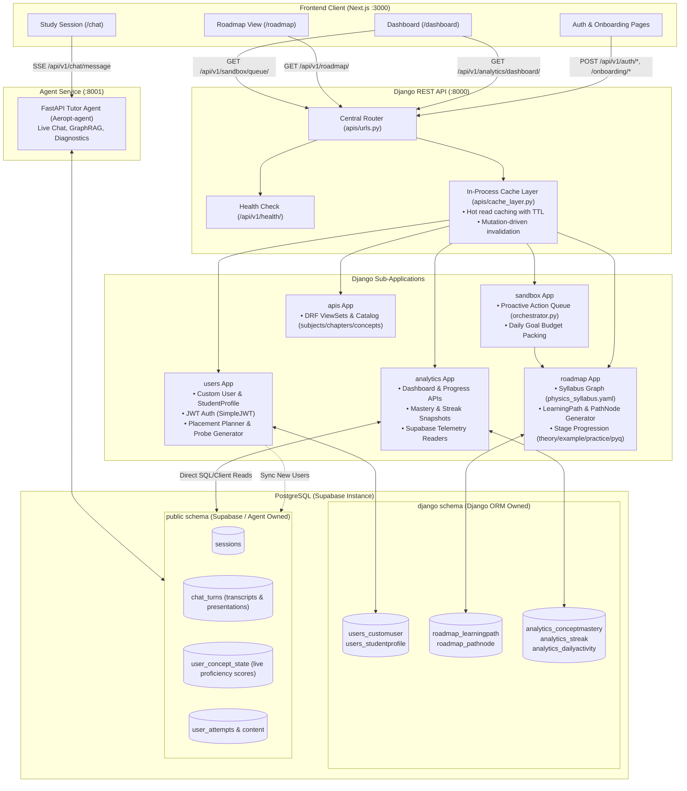
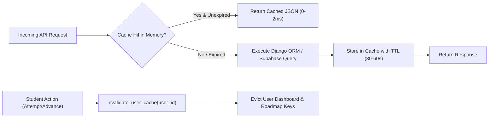
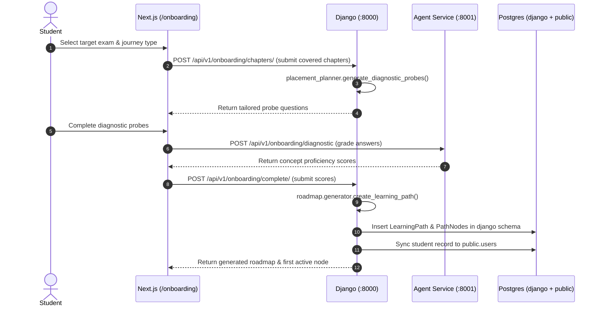
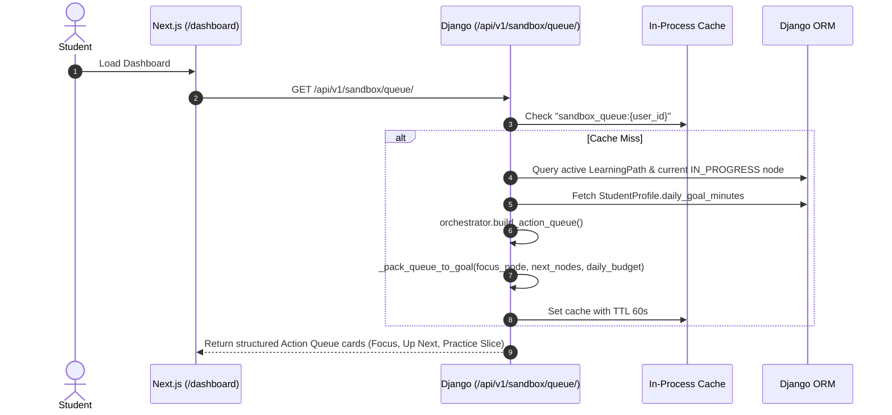
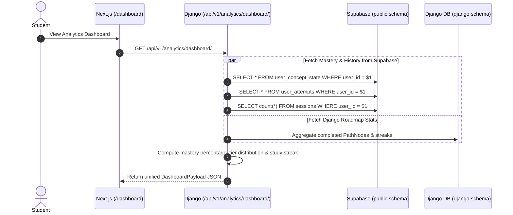

# PrepWise — Backend Service (`Aeropt-backend`)

Django REST Framework backend powering authentication, student onboarding, curriculum placement planning, dynamic roadmap progression, proactive action queuing, and analytics aggregation for **PrepWise**.

Built as part of **PrepWise** in collaboration with **KodeinKGP, IIT Kharagpur**.

---

## Table of Contents

1. [System Architecture](#system-architecture)
2. [Dual-Schema Database Design](#dual-schema-database-design)
3. [Component Breakdown](#component-breakdown)
4. [In-Process Caching Layer (`apis/cache_layer.py`)](#in-process-caching-layer)
5. [Key System Design Flows](#key-system-design-flows)
   - [A. Onboarding, Diagnostic Placement & Roadmap Generation](#a-onboarding-diagnostic-placement--roadmap-generation)
   - [B. Proactive Study Queue Calculation (Sandbox)](#b-proactive-study-queue-calculation-sandbox)
   - [C. Analytics Aggregation & Supabase Telemetry Sync](#c-analytics-aggregation--supabase-telemetry-sync)
6. [API Surface & Route Map](#api-surface--route-map)
7. [Local Setup & Verification](#local-setup--verification)

---

## System Architecture

The backend service runs on port **8000** using Django 5.1 and Django REST Framework. It serves as the authoritative authority for user identity, learning paths, and aggregated analytics, while delegating live conversational physics tutoring to the agent service (`Aeropt-agent` on port 8001).



---

## Dual-Schema Database Design

Both the Django backend and the Python agent connect to the same PostgreSQL instance in Supabase, using strict schema separation:

1. **`django` schema**:
   - Managed exclusively by Django migrations (`python manage.py migrate`).
   - Contains: User accounts, hashed credentials, StudentProfiles, Chapter preferences, LearningPath trees, PathNode stages, and aggregated Analytics snapshots.
   - Search path configured in `settings.py`: `-c search_path=django,public`.

2. **`public` schema**:
   - Managed by Supabase migrations and agent services.
   - Contains: High-throughput telemetry, raw `chat_turns`, LLM slide/flashcard presentations, `user_concept_state` WMA scores, and question bank `content`.
   - Django's `analytics/supabase_*.py` modules read directly from these tables to render unified dashboard metrics without duplicate writes.

---

## Component Breakdown

### 1. `users` Application
- **Custom User Model**: UUID-primary key user entity extending `AbstractUser`.
- **Student Profile (`StudentProfile`)**: Stores exam target (`JEE_MAIN`, `JEE_ADVANCED`), target year, daily goal minutes (default: 45 min), and explanation depth (`quick`, `standard`, `deep`).
- **Placement Planner (`placement_planner.py`)**: Computes diagnostic probe questions for student onboarding based on chosen journey (`fresh_start`, `mid_journey`, `revision_dropper`).
- **Supabase Sync Engine (`supabase_sync.py`)**: Synchronizes student records into Supabase `public.users` table so the agent service can immediately resolve user foreign keys.

### 2. `roadmap` Application
- **Syllabus Hierarchy**: Defines the JEE Physics topic tree via `roadmap/data/physics_syllabus.yaml`.
- **Learning Path Generator (`generator.py` & `engine.py`)**: Generates an ordered `LearningPath` comprised of `PathNode` records.
- **Node State Lifecycle**:
  $$\text{PENDING} \longrightarrow \text{IN\_PROGRESS} \longrightarrow \text{COMPLETED}$$
- Each node represents a specific concept broken into 4 mandatory study stages:
  1. `theory` (Conceptual fundamentals & slide deck)
  2. `example` (Step-by-step solved derivation)
  3. `practice` (Interactive question with hints)
  4. `pyq` (Past Year JEE exam question)

### 3. `analytics` Application
- **Multi-Source Aggregation**: Combines historical Django models with live Supabase telemetry:
  - `supabase_dashboard.py`: Computes current study streak, overall mastery %, and active goals.
  - `supabase_performance.py`: Extracts accuracy and speed across problem attempts.
  - `supabase_chat_history.py`: Retrieves session summaries and turn counts.
  - `supabase_briefing.py`: Generates mentor briefing cards for student review.
- **Mastery Distribution Engine**: Buckets concept proficiency into 4 tiers:
  - *Unseen* ($P < 0.15$)
  - *Emerging* ($0.15 \le P < 0.50$)
  - *Practicing* ($0.50 \le P < 0.75$)
  - *Mastered* ($P \ge 0.75$)

### 4. `sandbox` Application
- **Proactive Action Queue (`sandbox/orchestrator.py`)**: Dynamically computes today's recommended study tasks based on roadmap position and daily study goal.
- **Budget Packing Algorithm (`_pack_queue_to_goal`)**: Sizes the focus block (roughly 40% of target minutes) and selects next up-next nodes, scaling or trimming so total duration matches the student's daily goal.

### 5. `apis` Application
- **DRF Configuration Hub**: Provides shared base ViewSets, permission classes, and pagination.
- **In-Process Cache Layer (`apis/cache_layer.py`)**: In-memory caching for hot API endpoints.
- **Health Check (`HealthCheckView`)**: Liveness probe verifying database connectivity at `/api/v1/health/`.

---

## In-Process Caching Layer

To guarantee sub-15ms response times on dashboard and roadmap queries without external Redis overhead, `apis/cache_layer.py` implements an in-memory TTL cache:



---

## Key System Design Flows

### A. Onboarding, Diagnostic Placement & Roadmap Generation



---

### B. Proactive Study Queue Calculation (Sandbox)



---

### C. Analytics Aggregation & Supabase Telemetry Sync



---

## API Surface & Route Map

All API routes are versioned under `/api/v1/`.

| Method | Endpoint | Application | Description |
|---|---|---|---|
| `GET` | `/api/v1/health/` | `apis` | Database connectivity & service health check. |
| `POST` | `/api/v1/auth/register/` | `users` | Creates user account & student profile. |
| `POST` | `/api/v1/auth/token/` | `users` | Obtains JWT access & refresh token pair. |
| `POST` | `/api/v1/auth/token/refresh/` | `users` | Refreshes expired JWT access token. |
| `GET` | `/api/v1/auth/me/` | `users` | Returns authenticated student profile & preferences. |
| `POST` | `/api/v1/onboarding/chapters/` | `users` | Saves covered chapters during onboarding. |
| `GET` | `/api/v1/onboarding/placement-plan/` | `users` | Returns diagnostic probe question specs. |
| `POST` | `/api/v1/onboarding/complete/` | `users` | Finalizes onboarding and triggers roadmap generation. |
| `GET` | `/api/v1/roadmap/` | `roadmap` | Returns active learning path, chapters, and node tree. |
| `POST` | `/api/v1/roadmap/next/` | `roadmap` | Advances student to the next concept or study stage. |
| `GET` | `/api/v1/roadmap/progress/` | `roadmap` | Returns overall syllabus completion percentage. |
| `GET` | `/api/v1/sandbox/queue/` | `sandbox` | Computes today's proactive study action queue. |
| `GET` | `/api/v1/sandbox/readiness/` | `sandbox` | Returns exam readiness percentage & weak areas. |
| `GET` | `/api/v1/analytics/dashboard/` | `analytics` | Aggregated dashboard stats (streak, mastery %, goals). |
| `GET` | `/api/v1/analytics/progress/` | `analytics` | Detailed concept-by-concept mastery timeline. |
| `GET` | `/api/v1/concepts/` | `apis` | Catalog of 33 Physics concepts with prerequisites. |

---

## Local Setup & Verification

```bash
# 1. Activate virtual environment
cd Aeropt-backend
source .venv/bin/activate

# 2. Run migrations on django schema
python manage.py migrate

# 3. Verify deployment configuration
python manage.py check

# 4. Start local development server on port 8000
python manage.py runserver 8000
```
