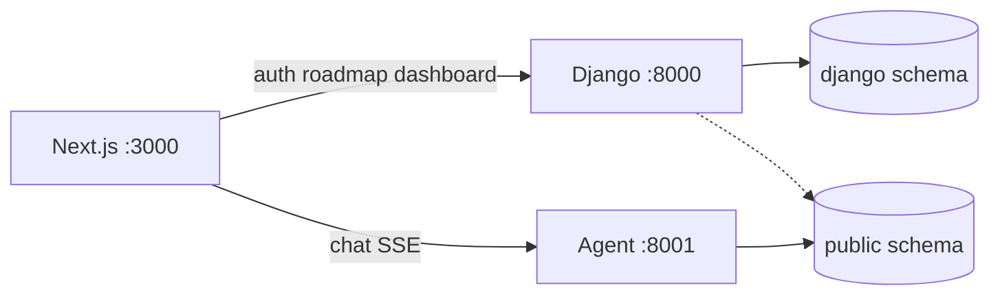

# PrepWise — Backend

Django REST API for auth, onboarding, roadmaps, the daily study queue, and
dashboard analytics. Live tutoring is **not** here: `/chat` goes to
`Aeropt-agent` on port 8001.

Port **8000**. Collaborators: KodeinKGP, IIT Kharagpur.

## What it owns

| App | Owns |
|---|---|
| `users` | Accounts, JWT, onboarding, `supabase_sync` into `public.users` |
| `roadmap` | PCM syllabus YAML → `LearningPath` / `PathNode` (theory → example → practice → pyq) |
| `analytics` | Dashboard and progress; reads agent tables in `public` |
| `sandbox` | Today's action queue, packed to `daily_goal_minutes` |
| `apis` | Health, catalog ViewSets, in-process cache |

One Postgres (Supabase): `django` schema = this ORM; `public` schema = agent.
Search path: `django,public`.



## HTTP

All student routes sit under `/api/v1/`. Schema UI: `/api/docs/`.

| Method | Path |
|---|---|
| GET | `/api/v1/health/` |
| POST | `/api/v1/auth/register/`, `/token/`, `/token/refresh/`, `/logout/` |
| GET | `/api/v1/auth/me/` |
| POST | `/api/v1/onboarding/chapters/`, `/complete/` |
| GET | `/api/v1/onboarding/placement-plan/` |
| GET | `/api/v1/roadmap/`, `/roadmap/subjects/`, `/roadmap/progress/` |
| POST | `/api/v1/roadmap/next/` |
| GET | `/api/v1/sandbox/queue/`, `/sandbox/readiness/` |
| GET | `/api/v1/analytics/dashboard/`, `/analytics/progress/` |
| GET | `/api/v1/subjects/`, `/chapters/`, `/concepts/`, `/content-items/` |

There is no Django chatbot. That app is gone.

## Run

```bash
cp .env.example .env   # SECRET_KEY, DB_PASSWORD or DATABASE_URL, SUPABASE_*
python -m venv .venv && source .venv/bin/activate
pip install -r requirements.txt
python manage.py migrate
make ci
python manage.py runserver 8000
```

`make ci` uses sqlite (`prepwise.ci_settings`) and does not touch live Supabase.
`make deploy` starts `:8000` if `/api/v1/health/` is down.
