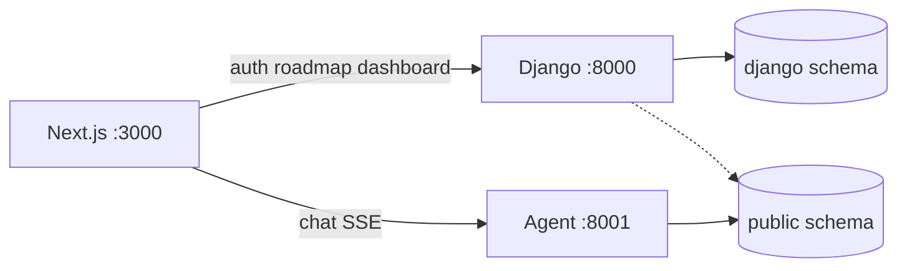

# PrepWise — Backend

Django REST API for auth, onboarding, roadmaps, the daily study queue, and
dashboard analytics. Live tutoring is **not** here: `/chat` goes to
`Aeropt-agent` on port 8001.

Port **8000**. Collaborators: KodeinKGP, IIT Kharagpur.

## What it owns

| App | Owns |
|---|---|
| `users` | Accounts, JWT, onboarding, `supabase_sync` into `public.users` |
| `roadmap` | PCM syllabus YAML → `LearningPath` / `PathNode` (theory → example → practice → pyq) |
| `analytics` | Dashboard and progress; reads agent tables in `public` |
| `sandbox` | Today's action queue, packed to `daily_goal_minutes` |
| `apis` | Health, catalog ViewSets, in-process cache |

One Postgres (Supabase): `django` schema = this ORM; `public` schema = agent.
Search path: `django,public`.



## HTTP

All student routes sit under `/api/v1/`. Schema UI: `/api/docs/`.

| Method | Path |
|---|---|
| GET | `/api/v1/health/` |
| POST | `/api/v1/auth/register/`, `/token/`, `/token/refresh/`, `/logout/` |
| GET | `/api/v1/auth/me/` |
| POST | `/api/v1/onboarding/chapters/`, `/complete/` |
| GET | `/api/v1/onboarding/placement-plan/` |
| GET | `/api/v1/roadmap/`, `/roadmap/subjects/`, `/roadmap/progress/` |
| POST | `/api/v1/roadmap/next/` |
| GET | `/api/v1/sandbox/queue/`, `/sandbox/readiness/` |
| GET | `/api/v1/analytics/dashboard/`, `/analytics/progress/` |
| GET | `/api/v1/subjects/`, `/chapters/`, `/concepts/`, `/content-items/` |

There is no Django chatbot. That app is gone.

## Run

```bash
cp .env.example .env   # SECRET_KEY, DB_PASSWORD or DATABASE_URL, SUPABASE_*
python -m venv .venv && source .venv/bin/activate
pip install -r requirements.txt
python manage.py migrate
make ci
python manage.py runserver 8000
```

`make ci` uses sqlite (`prepwise.ci_settings`) and does not touch live Supabase.
`make deploy` starts `:8000` if `/api/v1/health/` is down.

## Deploy

Container image: multi-stage, non-root (`uid 10001`), gunicorn, `collectstatic`
at build time, `HEALTHCHECK` on `/api/v1/health/`.

```bash
docker build -t prepwise-backend .
docker run --rm -p 8000:8000 --env-file .env \
  -e DEBUG=False -e BEHIND_TLS=True -e ALLOWED_HOSTS=api.example.com \
  prepwise-backend
curl -fsS localhost:8000/api/v1/health/
```

Worker/timeout tuning lives in `gunicorn.conf.py` (`workers = 2 * cpu + 1` by
default, override with `WEB_CONCURRENCY`). Migrations are **not** run by the
image — run them as a release step:

```bash
docker run --rm --env-file .env prepwise-backend python manage.py migrate
```

Before deploying, confirm the checklist is clean:

```bash
DEBUG=False BEHIND_TLS=True python manage.py check --deploy
```

The only warnings expected there are `drf_spectacular.W002` (APIViews without a
declared serializer — cosmetic, schema-only) and `security.W021`
(`SECURE_HSTS_PRELOAD`, deliberately opt-in because HSTS preload is effectively
irreversible).

### Operations

- **Logging.** `settings.LOGGING` writes one formatted line per record to
  stdout: `<time> <LEVEL> [<request-id>] <logger>: <message>`. Set
  `LOG_FORMAT=json` for one JSON object per line in an aggregator.
- **Request correlation.** `prepwise.middleware.RequestIDMiddleware` reuses an
  inbound `X-Request-ID` (8–64 chars of `[A-Za-z0-9._-]`) or generates one,
  exposes it as `request.request_id`, returns it in the `X-Request-ID` response
  header, and binds it to every log line of that request. A frontend bug report
  quoting the header maps straight onto backend logs:
  `grep <id> backend.log`.
- **Throttling.** DRF throttles are global (`prepwise/throttling.py`):
  `auth` (per-IP, credential endpoints only), `anon` (per-IP), `user`
  (per-user). Over-limit requests get `429` with `Retry-After`. `/api/v1/health/`
  is exempt. Rates are env-tunable; they are disabled in `ci_settings`.
  **Counters live in the LocMem cache, so they are per worker process** — with
  `WEB_CONCURRENCY=9` a single client can reach up to 9x the configured rate
  before it is reliably blocked. Good enough as abuse protection, not an exact
  quota; making it exact needs a shared cache (Redis/Memcached), which is an
  infra decision this pass deliberately did not take.
- **Health.** `/api/v1/health/` returns `{status, version, request_id, checks}`
  with a `SELECT 1` DB ping and whether Supabase credentials are configured. It
  never calls Supabase. `503` when the DB ping fails.

## Environment variables

Existing keys (`SECRET_KEY`, `DEBUG`, `ALLOWED_HOSTS`, `DATABASE_URL` /
`DB_*`, `SUPABASE_URL`, `SUPABASE_KEY`, `CORS_ALLOWED_ORIGINS`,
`DEV_AUTH_BYPASS*`, `GROQ_*`) are unchanged. Added by the hardening pass:

| Var | Default | Purpose |
|---|---|---|
| `BEHIND_TLS` | `False` | Master switch for TLS-dependent settings: `SECURE_SSL_REDIRECT`, `SESSION_COOKIE_SECURE`, `CSRF_COOKIE_SECURE`, HSTS, `SECURE_PROXY_SSL_HEADER`. Set `True` only where HTTPS is terminated in front of the app — turning it on without TLS causes redirect loops and dropped cookies. |
| `SECURE_HSTS_SECONDS` | `31536000` | HSTS max-age. Ignored (forced to `0`) unless `BEHIND_TLS=True`. |
| `SECURE_HSTS_INCLUDE_SUBDOMAINS` | `True` | Sent only when `BEHIND_TLS=True`. |
| `SECURE_HSTS_PRELOAD` | `False` | Opt-in: preload submission is hard to undo. |
| `CSRF_TRUSTED_ORIGINS` | *(empty)* | Comma-separated scheme-qualified origins for session/CSRF POSTs (admin, DRF browsable API) over HTTPS. Not needed by the JWT API. |
| `DATA_UPLOAD_MAX_MEMORY_SIZE` | `5242880` | Request body cap (bytes). |
| `STATIC_ROOT` | `<repo>/staticfiles` | `collectstatic` target. |
| `LOG_LEVEL` | `DEBUG` when `DEBUG=True`, else `INFO` | Level for root + app loggers. |
| `LOG_FORMAT` | `plain` | `plain` or `json`. |
| `SQL_LOG_LEVEL` | `WARNING` | `django.db.backends`; set `DEBUG` to see every statement. |
| `THROTTLE_AUTH_RATE` | `20/min` | Per-IP limit on `auth/register/`, `auth/token/`, `auth/token/refresh/`. |
| `THROTTLE_ANON_RATE` | `60/min` | Per-IP limit for unauthenticated requests. |
| `THROTTLE_USER_RATE` | `600/min` | Per-user limit. Frontend caches reads for 30 s–10 min (`src/lib/apiCache.ts`), so normal use is orders of magnitude below this. |
| `CI_HARDENING_LIVE` | unset | `prepwise.ci_settings` only: keep the real logging levels and throttle rates instead of the CI-relaxed ones, so the hardening can be exercised against throwaway sqlite (`CI_HARDENING_LIVE=1 DJANGO_SETTINGS_MODULE=prepwise.ci_settings python manage.py runserver 8011`). |
| `PORT` / `GUNICORN_BIND` | `8000` / `0.0.0.0:$PORT` | Bind address. |
| `WEB_CONCURRENCY` | `2 * cpu + 1` | Gunicorn workers. Also `GUNICORN_THREADS`, `GUNICORN_TIMEOUT`, `GUNICORN_MAX_REQUESTS`, `GUNICORN_LOG_LEVEL`, `GUNICORN_ACCESS_LOG`, `GUNICORN_PRELOAD`. |
